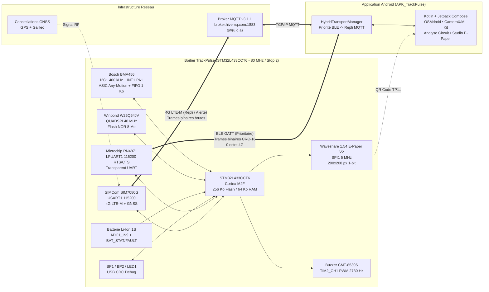
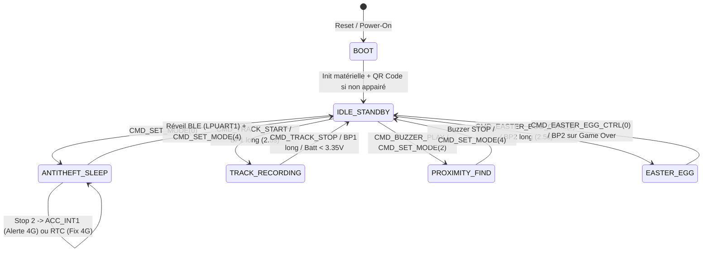
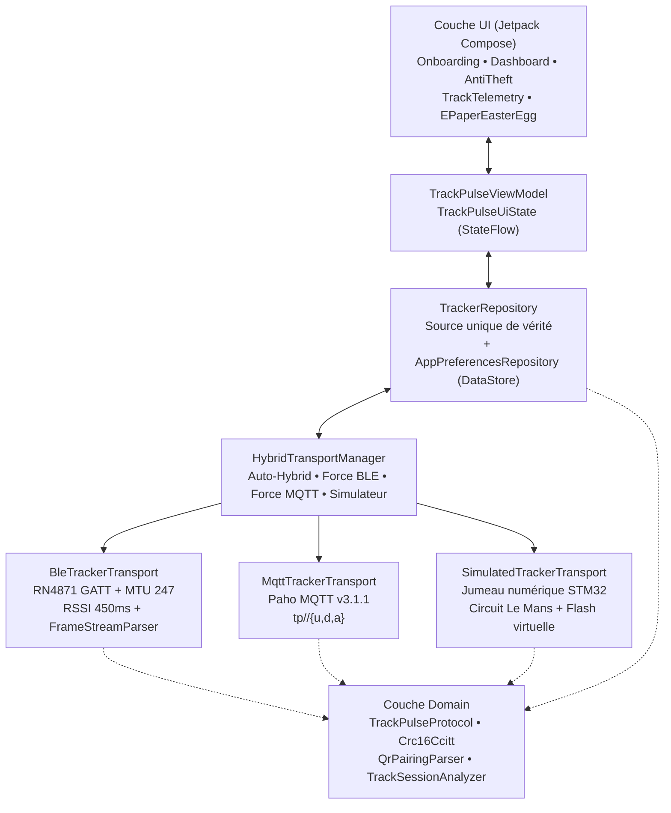

# Rapport Technique Complet — Projet TrackPulse

> **Système embarqué autonome hybride (Antivol IoT longue autonomie & Télémétrie Circuit haute fréquence)**  
> **Plateforme matérielle :** STM32L433CCT6 (ARM Cortex-M4F) • Bosch BMA456 • Microchip RN4871 (BLE) • SIMCom SIM7080G (4G LTE-M / GNSS) • Winbond W25Q64JV (Flash NOR 8 Mo QSPI) • Waveshare 1,54" E-Paper V2 (200×200 px)  
> **Application compagnon :** Android Kotlin / Jetpack Compose (`APK_TrackPulse`)  
> **Firmware embarqué :** C11 / STM32 HAL / CMake + Ninja (`CODE_TrackPulse`)

---

## Table des matières

1. [Présentation générale et objectifs du projet](#1-présentation-générale-et-objectifs-du-projet)
2. [Architecture globale du système](#2-architecture-globale-du-système)
3. [Architecture matérielle et configuration STM32L433CCT6](#3-architecture-matérielle-et-configuration-stm32l433cct6)
   - 3.1 [Choix du microcontrôleur et arbre d'horloges](#31-choix-du-microcontrôleur-et-arbre-dhorloges)
   - 3.2 [Affectation complète des périphériques et brochage (Pinout)](#32-affectation-complète-des-périphériques-et-brochage-pinout)
   - 3.3 [Conception et justification des sous-systèmes matériels](#33-conception-et-justification-des-sous-systèmes-matériels)
4. [Protocole de communication binaire unifié (v1.0)](#4-protocole-de-communication-binaire-unifié-v10)
   - 4.1 [Philosophie et budget data 4G (forfait 500 Mo)](#41-philosophie-et-budget-data-4g-forfait-500-mo)
   - 4.2 [Structure de la trame binaire et intégrité CRC-16](#42-structure-de-la-trame-binaire-et-intégrité-crc-16)
   - 4.3 [Catalogue complet des opcodes et structures](#43-catalogue-complet-des-opcodes-et-structures)
   - 4.4 [Appairage rapide par QR Code compact (`TP1`)](#44-appairage-rapide-par-qr-code-compact-tp1)
5. [Architecture et implémentation du firmware STM32 (`CODE_TrackPulse`)](#5-architecture-et-implémentation-du-firmware-stm32-code_trackpulse)
   - 5.1 [Organisation modulaire, compatibilité CubeMX et chaîne CMake](#51-organisation-modulaire-compatibilité-cubemx-et-chaîne-cmake)
   - 5.2 [Accéléromètre Bosch BMA456 : ASIC Any-Motion & FIFO 1 Ko](#52-accéléromètre-bosch-bma456--asic-any-motion--fifo-1-ko)
   - 5.3 [Mémoire Flash NOR 8 Mo QSPI (`W25Q64JV`) et système de fichiers léger](#53-mémoire-flash-nor-8-mo-qspi-w25q64jv-et-système-de-fichiers-léger)
   - 5.4 [Connectivité hybride : BLE RN4871, 4G LTE-M / GNSS / MQTT SIM7080G & A-GPS](#54-connectivité-hybride--ble-rn4871-4g-lte-m--gnss--mqtt-sim7080g--a-gps)
   - 5.5 [Écran Waveshare 1,54" E-Paper V2, générateur QR Code & mini-jeux Easter Egg](#55-écran-waveshare-154-e-paper-v2-générateur-qr-code--mini-jeux-easter-egg)
   - 5.6 [Gestion batterie, buzzer PWM et gestion d'énergie `Stop 2`](#56-gestion-batterie-buzzer-pwm-et-gestion-dénergie-stop-2)
   - 5.7 [Machine à états applicative et commandes locales](#57-machine-à-états-applicative-et-commandes-locales)
   - 5.8 [Empreinte mémoire compilée et bilan énergétique](#58-empreinte-mémoire-compilée-et-bilan-énergétique)
6. [Application mobile Android (`APK_TrackPulse`)](#6-application-mobile-android-apk_trackpulse)
   - 6.1 [Stack technologique et permissions Android 10–15+](#61-stack-technologique-et-permissions-android-1015)
   - 6.2 [Architecture logicielle MVVM & flux réactifs](#62-architecture-logicielle-mvvm--flux-réactifs)
   - 6.3 [Couche de transport hybride et simulateur STM32 intégré](#63-couche-de-transport-hybride-et-simulateur-stm32-intégré)
   - 6.4 [Écrans fonctionnels et moteur d'analyse télémétrique](#64-écrans-fonctionnels-et-moteur-danalyse-télémétrique)
7. [Synthèse des choix techniques et compromis d'ingénierie](#7-synthèse-des-choix-techniques-et-compromis-dingénierie)
8. [Axes d'amélioration et perspectives](#8-axes-damélioration-et-perspectives)

---

## 1. Présentation générale et objectifs du projet

**TrackPulse** est un boîtier électronique autonome conçu sur mesure qui réunit deux cas d'usage habituellement antagonistes sur le plan énergétique et matériel :

1. **Traceur Antivol IoT ultra-basse consommation :**
   - Veille profonde (`Stop 2`) capable de tenir plusieurs semaines/mois sur une batterie Li-Ion 1S.
   - Détection matérielle autonome de mouvement suspect (choc, soulèvement, remorquage) sans réveiller inutilement le microcontrôleur tant que le véhicule est immobile.
   - Envoi d'alertes critiques et de positions périodiques via **4G LTE-M / NB-IoT + MQTT binaire** en préservant un forfait SIM IoT contraint (**500 Mo**, typiquement 1NCE).
   - Localisation de proximité (**Proximity Finder**) couplant la mesure **RSSI BLE** en temps réel et un **buzzer piézo/magnétique PWM** pilotable à distance.

2. **Enregistreur de Télémétrie Circuit haute fréquence (Kart / Moto / Voiture) :**
   - Acquisition synchrone de la trajectoire **GNSS (GPS + Galileo)** et de l'accélération 3 axes **16 bits** (jusqu'à 100 Hz, ±2g à ±16g) sans perte d'échantillons grâce au **FIFO matériel 1 Ko** du BMA456.
   - Stockage local haute capacité dans une mémoire **Flash NOR 8 Mo en Quad-SPI (40 MHz)** capable de mémoriser plus de **520 000 points** (soit ~14 h 26 à 10 Hz ou ~2 h 53 à 50 Hz).
   - Rapatriement rapide des sessions vers le smartphone **strictement en BLE** (zéro octet 4G consommé) pour analyse post-roulage (carte colorée par vitesse, détection automatique des tours, diagramme de friction G-Force).

3. **Interface Homme-Machine (IHM) autonome et ludique :**
   - Écran **Waveshare 1,54" E-Paper V2 (200×200 px)** conservant l'affichage à courant nul, capable d'afficher un **QR Code d'appairage** au premier démarrage, le statut antivol, un compteur HUD circuit ou des cartes personnalisées.
   - **Mode Easter Egg** embarquant deux mini-jeux jouables directement sur le boîtier grâce aux deux boutons physiques (`BP1`/`BP2`), au rafraîchissement partiel E-Paper (`0,3 s`) et aux effets sonores du buzzer, avec persistance et synchronisation des records vers l'application Android.

---

## 2. Architecture globale du système

Le système repose sur une **connectivité hybride asymétrique** pilotée par le même protocole binaire sur les deux canaux radio :

- **À courte portée (BLE RN4871) :** priorité absolue. Latence < 30 ms, débit utile ~8–10 Ko/s, **0 octet 4G consommé**. Utilisé pour la télémétrie live, l'injection A-GPS automatique, la configuration E-Paper, le Proximity Finder et le déchargement de la Flash NOR 8 Mo.
- **À longue distance (4G LTE-M SIM7080G + MQTT v3.1.1) :** activé uniquement en l'absence de lien BLE (alerte vol, réveil périodique RTC, ou interrogation à la demande). Le modem est totalement éteint (`AT+CPOWD=1`) le reste du temps.



---

## 3. Architecture matérielle et configuration STM32L433CCT6

### 3.1 Choix du microcontrôleur et arbre d'horloges

Le **STM32L433CCT6** (boîtier LQFP48, 256 Ko Flash, 64 Ko SRAM répartis en 48 Ko SRAM1 + 16 Ko SRAM2) a été sélectionné pour sa combinaison rare dans la gamme STM32 :
- **Mode `Stop 2` natif à ~1,4 µA** tout en conservant la totalité de la RAM, le RTC actif sur LSE, les interruptions EXTI (`ACC_INT1`) et la capacité de réveil sur **LPUART1** (`UART_WAKEUP_ON_STARTBIT`).
- **Stratégie *Race-to-Sleep* à 80 MHz :** exécution rapide des traitements (CRC-16, Reed-Solomon QR Code, décodage PackBits, calculs flottants via FPU matérielle Cortex-M4F) afin de retourner le plus vite possible en `Stop 2`.
- **Périphérique `QUADSPI` matériel** pour exploiter la Flash 8 Mo sur 4 lignes de données à 40 MHz.
- **USB Full Speed *crystal-less*** grâce à l'oscillateur interne `HSI48` synchronisé automatiquement sur les paquets USB SOF par le module `CRS` (Clock Recovery System), économisant un quartz HSE externe.

#### Configuration exacte des horloges (`SystemClock_Config` dans `Core/Src/main.c`)

| Domaine / Source | Configuration STM32CubeMX | Fréquence | Rôle et justification |
|---|---|---|---|
| **LSE** (Quartz 32,768 kHz) | `RCC_LSE_ON`, `RCC_LSEDRIVE_LOW` | **32,768 kHz** | Horloge de référence RTC (`AsynchPrediv=127`, `SynchPrediv=255` → `ck_spre` = 1 Hz exact) et auto-calibration matérielle du MSI (`HAL_RCCEx_EnableMSIPLLMode`). |
| **MSI** | `RCC_MSIRANGE_6` (PLL-mode sur LSE) | **4 MHz** | Source stable (±0,25 % grâce au LSE) alimentant la PLL principale et servant d'horloge instantanée au réveil de `Stop 2`. |
| **PLL Principale** | `PLLM=1`, `PLLN=40`, `PLLR=2` (`SCALE1`, `FLASH_LATENCY_4`) | **80 MHz** | `SYSCLK = HCLK = PCLK1 = PCLK2 = 80 MHz`. Puissance maximale pour le *Race-to-Sleep*. |
| **HSI16** | `RCC_HSI_ON` | **16 MHz** | Horloge dédiée à `LPUART1` (`RCC_LPUART1CLKSOURCE_HSI`). **Indispensable** pour autoriser le réveil du STM32 depuis `Stop 2` sur réception d'un octet BLE à 115 200 bauds (impossible avec PCLK1 coupé en Stop 2). |
| **HSI48 + CRS** | `RCC_CRS_SYNC_SOURCE_USB` | **48 MHz** | Horloge précise pour le périphérique USB CDC VCP (console de diagnostic). |
| **PLLSAI1** | `Source=MSI`, `M=1`, `N=24`, `R=2` | **48 MHz** | Horloge asynchrone dédiée à `ADC1` (`PCLK_DIV4` synchrone dans `MX_ADC1_Init`). |

---

### 3.2 Affectation complète des périphériques et brochage (Pinout)

Le mappage ci-dessous est vérifié par rapport aux schémas électroniques et aux fichiers générés `Core/Inc/main.h`, `Core/Src/main.c` et `Core/Src/stm32l4xx_hal_msp.c`.

| Sous-système | Composant | Périphérique STM32 | Broches exactes | Paramètres clés |
|---|---|---|---|---|
| **Bluetooth Low Energy** | Microchip **RN4871** | `LPUART1` (AF8) + GPIO | `PB10` (RX), `PB11` (TX), `PB12` (RTS), `PB13` (CTS), `PH0` (`RST_BLE`) | 115 200 bauds, **8-N-1**, contrôle de flux matériel **RTS/CTS**, horloge HSI16, `LPUART1_IRQn` prio 1. |
| **Modem 4G & GNSS** | SIMCom **SIM7080G** | `USART1` (AF7) + GPIO | `PA9` (TX), `PA10` (RX), `PB14` (`PWRKEY`), `PB3` (`DTR_SIM7080G`) | 115 200 bauds, 8-N-1, sans RTS/CTS, `USART1_IRQn` prio 0. |
| **Flash NOR 8 Mo** | Winbond **W25Q64JVSSIQ** | `QUADSPI` Bank 1 (AF10) | `PA2` (NCS), `PA3` (CLK), `PB1` (IO0), `PB0` (IO1), `PA7` (IO2), `PA6` (IO3) | **40 MHz** (`Prescaler=1`), `FlashSize=22` ($2^{22+1} = 8\text{ Mo}$), Mode 0, `CS High Time = 5 cycles`. |
| **Accéléromètre 3 axes** | Bosch **BMA456** | `I2C1` (AF4) + `EXTI1` | `PB8` (SCL), `PB9` (SDA), `PA1` (`ACC_INT1` EXTI1 front montant) | **Fast Mode 400 kHz** (`Timing = 0x00F12981`), adresse 7 bits `0x18` (`SDO=GND`, `CSB=+3V3`), pull-ups `R14/R15 = 4,7 kΩ`. |
| **Écran E-Paper** | Waveshare **1,54" V2** (SSD1681) | `SPI1` (AF5) + GPIO | `PA5` (SCK), `PB5` (MOSI), `PH1` (`EPD_CS`), `PA15` (`EPD_DC`), `PA8` (`EPD_RST`), `PB15` (`EPD_BUSY`) | **5 MHz** (`Prescaler=16`), Mode 0 (CPOL=0, CPHA=0), MSB first, NSS logiciel. |
| **Buzzer** | **CMT-8530S-SMT** + MOSFET Q2 | `TIM2_CH1` (AF1) | `PA0` (`TIM2_CH1`) | Base **1 MHz** (`PSC=79`), défaut 2 730 Hz (`ARR=365`, `CCR1=183`), PWM1 avec preload. |
| **Surveillance Batterie** | Li-Ion 1S + Chargeur | `ADC1_IN9` + GPIO | `PA4` (`BAT_SENSE`), `PB6` (`BAT_STAT` pull-up), `PB7` (`FAULT` pull-up) | 12 bits, `640.5` cycles d'échantillonnage, pont diviseur `R11/R13 = 1 MΩ / 1 MΩ`. |
| **IHM Locale & Debug** | 2 boutons, 1 LED, USB | GPIO + `USB_OTG_FS` | `PB2` (`BP1` actif bas), `PC13` (`BP2` actif bas), `PB4` (`LED1` actif haut), `PA11/PA12` (USB D-/D+) | Pull-up interne sur `BP1`/`BP2`, console série virtuelle USB CDC non-bloquante. |

---

### 3.3 Conception et justification des sous-systèmes matériels

#### Remplacement du LIS3DH par le Bosch BMA456 & dimensionnement du bus I2C1
Suite à l'indisponibilité d'approvisionnement du ST LIS3DH, la carte a été adaptée pour un **Bosch BMA456** (`U6`) conservant un brochage quasi identique (`CSB = +3V3` pour verrouiller l'I2C au POR, `SDO = GND` → adresse 7 bits `0x18`, `INT1 → PA1`, découplages `C19/C20 = 100 nF`, `ASCL/ASDA` non connectés).

Le **BMA456** apporte trois avantages décisifs par rapport au LIS3DH :
1. **Résolution 16 bits native** (sensibilité exacte $S = 32768 / \text{range}_g\text{ LSB/g}$) avec bruit réduit.
2. **Moteur ASIC embarqué `BMA456_AN`** exécutant un algorithme *Any-Motion* matériel filtré directement sur le silicium : le STM32 reste en `Stop 2` avec **0 réveil périodique** tant que le véhicule ne bouge pas.
3. **FIFO matériel de 1 024 octets** (170 échantillons XYZ sans en-tête de 6 octets, soit **3,4 s de tampon à 50 Hz**) garantissant zéro perte de données télémétriques pendant les rafraîchissements E-Paper (0,3–2,0 s) ou les effacements de secteurs Flash NOR (45–400 ms).

**Pourquoi I2C1 est réglé en Fast Mode 400 kHz (`0x00F12981`) et NON en Fast Mode Plus (1 000 kHz) :**  
Sur le schéma, les résistances de pull-up `R14` et `R15` valent **4,7 kΩ**. Avec une capacité parasite de bus typique $C_{\text{bus}} \approx 35\text{ pF}$ (pistes PCB + broches STM32 + BMA456), le temps de montée RC est d'environ :
$$t_r \approx 0{,}85 \times R \times C_{\text{bus}} \approx 0{,}85 \times 4700\,\Omega \times 35\,\text{pF} \approx 140\,\text{ns}$$
- En **Fast Mode (400 kHz)**, la spécification I2C et la datasheet BMA456 autorisent $t_r \le 300\text{ ns}$ : la marge de sécurité dépasse **2×**, et un burst de 32 échantillons FIFO (192 o) ne prend que **~4,3 ms**.
- En **Fast Mode Plus (1 000 kHz)**, la limite tombe à $t_r \le 120\text{ ns}$ : le bus risquerait des erreurs NACK/corruption sans abaisser `R14/R15` à 1–1,5 kΩ (au prix d'une surconsommation sur les pull-ups). **400 kHz constitue donc l'optimum fiabilité/vitesse/conso du PCB.**

#### Mesure batterie haute impédance (`R11 = R13 = 1 MΩ`)
Un pont diviseur par 2 réalisé avec deux résistances de **1 MΩ** limite le courant de fuite permanent sur la batterie à seulement **$I_{\text{div}} \approx 4{,}0\,\text{V} / 2\,\text{M}\Omega = 2\,\mu\text{A}$**. En contrepartie, l'impédance de source vue par `ADC1_IN9` vaut $R_{\text{eq}} = 500\,\text{k}\Omega$.  
C'est pourquoi `ADC1` est impérativement configuré avec le temps d'échantillonnage maximal (**`ADC_SAMPLETIME_640CYCLES_5`**) afin de laisser le condensateur interne *Sample & Hold* se charger complètement sans erreur de mesure, complété par une calibration single-ended au boot, un moyennage de 8 conversions et un filtrage EMA ($\alpha = 0{,}25$) supprimant les creux de tension dus aux pics RF du modem 4G ou au buzzer.

#### Protection matérielle sur `RST_BLE` (`PH0`) et Buzzer (`PA0`)
- **`RST_BLE` maintenu à l'état HAUT en veille :** l'entrée reset du RN4871 est active bas avec une résistance de pull-up externe (`R12`). Forcer `PH0` à LOW en veille provoquerait une fuite inutile de ~330 µA ; le firmware maintient donc `PH0 = HIGH` en permanence hors impulsion de reset initial de 10 ms.
- **`CCR1 = 0` systématique à l'arrêt du buzzer :** le buzzer CMT-8530S-SMT est commandé via un MOSFET N-Channel (`Q2`, AO3400A). Arrêter le timer alors que la sortie serait figée à l'état HAUT saturerait `Q2` en continu et ferait circuler un courant destructeur dans la bobine. `tp_buzzer_stop()` force toujours `CCR1 = 0` avant `HAL_TIM_PWM_Stop()`, et une sécurité matérielle/logicielle coupe automatiquement toute mélodie après **30 secondes** maximum.

---

## 4. Protocole de communication binaire unifié (v1.0)

Spécifié dans `APK_TrackPulse/PROTOCOL.md`, le protocole constitue le **contrat d'interface strict** entre le firmware C STM32 et l'application Kotlin Android.

### 4.1 Philosophie et budget data 4G (forfait 500 Mo)

Trois décisions structurantes guident ce protocole :
1. **Format binaire strict en Little-Endian** (natif sur Cortex-M4F et via `ByteBuffer.LITTLE_ENDIAN` sur Android) — aucun texte JSON/XML, aucune clé redondante.
2. **Parseur unique partagé** entre BLE Transparent UART et MQTT 4G : les payloads publiés sur les topics MQTT sont exactement les mêmes trames binaires que celles transitant sur `LPUART1`.
3. **Verrouillage des transferts massifs au canal BLE :** les commandes `CMD_FLASH_LIST`, `CMD_FLASH_READ`, `CMD_FLASH_ERASE_SESSION`, `CMD_FLASH_FORMAT` et `CMD_INJECT_AGPS` sont refusées avec le code `ERR_BLE_ONLY (0x06)` si reçues sur 4G.

#### Topics MQTT ultra-courts et estimation de consommation sur 500 Mo

| Direction | Topic MQTT | QoS | Retain | Rôle |
|---|---|---|---|---|
| **Boîtier → App** | `tp/<devId>/u` | `0` | `false` | Télémétrie périodique (`EVT_STATUS`), réponses `RSP_ACK`, scores |
| **App → Boîtier** | `tp/<devId>/d` | `1` | `false` | Commandes distantes (`CMD_REQUEST_FIX`, `CMD_SET_MODE`, `CMD_BUZZER_PLAY`) |
| **Boîtier → App (Vol)** | `tp/<devId>/a` | `1` | `true` | Alerte antivol prioritaire (`EVT_MOTION_ALERT`), conservée par le broker |

| Événement | Payload | Trame complète | Coût total MQTT + TCP/IP | Impact sur 500 Mo |
|---|---|---|---|---|
| Heartbeat / Position (`EVT_STATUS`) | 25 o | 34 o | ~110 o | **~4,5 millions de positions** |
| Alerte vol (`EVT_MOTION_ALERT`) | 19 o | 28 o | ~105 o | Négligeable |
| Demande fix (`CMD_REQUEST_FIX`) | 2 o | 11 o | ~85 o | Négligeable |
| **1 position / heure pendant 1 an** | — | — | **~0,96 Mo / an** | **0,19 % du forfait** |

---

### 4.2 Structure de la trame binaire et intégrité CRC-16

Chaque trame a un **surcoût fixe de 9 octets** (7 octets d'en-tête + 2 octets de CRC) et transporte de 0 à 240 octets de charge utile (compatible avec un seul paquet GATT lorsque le MTU est négocié à 247 octets) :

```text
+--------+--------+---------+--------+--------+--------+--------+------------------+--------+--------+
|  0xAA  |  0x55  | VER|FLG | OPCODE |  SEQ   | LEN_L  | LEN_H  |     PAYLOAD      | CRC_L  | CRC_H  |
+--------+--------+---------+--------+--------+--------+--------+------------------+--------+--------+
  Byte 0   Byte 1   Byte 2    Byte 3   Byte 4   Byte 5   Byte 6    7 .. 7+LEN-1      7+LEN    8+LEN
```

- **`SOF` (`0xAA 0x55`) :** séquence de resynchronisation flux série.
- **`VER|FLG` :** nibble haut = version (`0x1`) ; nibble bas = drapeaux (`b0 = ACK_REQ`, `b1 = IS_4G_CHANNEL`).
- **`OPCODE` :** `0x01..0x7F` (App → STM32), `0x80..0xFF` (STM32 → App).
- **`SEQ` (`0..255`) :** numéro de séquence roulant pour corrélation requête/acquittement et déduplication.
- **`CRC16` :** **CRC-16/CCITT-FALSE** (polynôme `0x1021`, valeur initiale `0xFFFF`, sans réflexion, xorout `0x0000`) calculé sur `VER_FLAGS .. fin PAYLOAD`.
- **Sécurité de réassemblage :** un timeout de **250 ms** réinitialise automatiquement l'automate du parseur STM32 si une trame est tronquée sur le lien série.

---

### 4.3 Catalogue complet des opcodes et structures

Toutes les structures C (`__attribute__((packed))`) définies dans `App/Inc/tp_protocol.h` sont vérifiées à la compilation par **15 assertions `_Static_assert`** garantissant une correspondance octet-par-octet avec `TrackPulseProtocol.kt`.

| Catégorie | Opcode | Nom | Sens | Taille Payload | Rôle principal |
|---|---|---|---|---|---|
| **Système** | `0x01` | `CMD_PING` | App → MCU | 0 o | Test de présence et latence |
| | `0x81` | `RSP_ACK` | MCU → App | 3 o | Acquittement (`origOpcode`, `origSeq`, `status`) |
| | `0x02` | `CMD_GET_STATUS` | App → MCU | 0 o | Requête état complet |
| | `0x82` | `EVT_STATUS` | MCU → App | **25 o** | Mode, drapeaux, batterie mV/%, Flash, GPS, uptime, E-Paper |
| | `0x03` | `CMD_SET_MODE` | App → MCU | **4 o** | Changement mode + `rtc_wake_sec` + seuil mouvement (×16 mg) |
| | `0x04` | `CMD_INJECT_AGPS` | App → MCU | **19 o** | Injection UTC + position smartphone (BLE uniquement) |
| | `0x05` | `CMD_BUZZER_PLAY` | App → MCU | **3 o** | Mélodie (0..5), répétitions (0..10), tempo (5..20) |
| | `0x06` | `CMD_REQUEST_FIX` | App → MCU | **2 o** | Demande fix GNSS immédiat (`timeoutSec`) |
| | `0x08` | `CMD_PAIR_HANDSHAKE` | App → MCU | **10 o** | Validation clé d'appairage QR (`pairingKey[10]`) |
| **Antivol** | `0xA0` | `EVT_MOTION_ALERT` | MCU → App | **19 o** | Alerte choc/inclinaison (`peak_mg`, `axis_mask`, GPS, batterie) |
| | `0x07` | `CMD_CLEAR_ALERT` | App → MCU | 1 o | Acquittement alerte et réarmement `ACC_INT1` |
| **Circuit & Flash** | `0x10` | `CMD_TRACK_START` | App → MCU | **4 o** | Démarre session (`rateHz`, `rangeG`, `vehicleType`, `flags`) |
| | `0x11` | `CMD_TRACK_STOP` | App → MCU | 0 o | Clôture session et finalise l'entrée Flash |
| | `0x12` | `CMD_FLASH_LIST` | App → MCU | 0 o | Liste des sessions stockées (BLE only) |
| | `0x92` | `RSP_FLASH_SESSION` | MCU → App | **24 o** | En-tête session (`index/count`, durée, pts, Vmax, Gmax) |
| | `0x13` | `CMD_FLASH_READ` | App → MCU | **8 o** | Lecture bloc (`sessionId`, `offset`, `maxLen` ≤ 224 o) (BLE only) |
| | `0x93` | `RSP_FLASH_CHUNK` | MCU → App | **8 + 16N o** | Bloc jusqu'à 14 échantillons de 16 o (`is_last_chunk`) |
| | `0x14` | `CMD_FLASH_ERASE_SESSION` | App → MCU | 2 o | Suppression logique d'une session (BLE only) |
| | `0x15` | `CMD_FLASH_FORMAT` | App → MCU | 4 o | Formatage sécurisé par clé magique `0xDEADBEEF` (BLE only) |
| | `0xA1` | `EVT_LIVE_TELEMETRY` | MCU → App | **16 o** | Flux télémétrie temps réel en BLE (~5 Hz) |
| **E-Paper & Jeu** | `0x20` | `CMD_EPAPER_CONFIG` | App → MCU | **60 o** | Gabarit (0..4), rafraîchissement, options, titre/sous-titre |
| | `0x21` | `CMD_EPAPER_BITMAP` | App → MCU | **6 + N o** | Image 200×200 (5 000 o brut ou PackBits RLE) par blocs |
| | `0x30` | `CMD_EASTER_EGG_CTRL` | App → MCU | **3 o** | Lancer/quitter/synchroniser/réinitialiser un mini-jeu |
| | `0xB0` | `EVT_EASTER_EGG_SCORE` | MCU → App | **13 o** | Dernier score, record Flash, parties jouées, temps cumulé |

---

### 4.4 Appairage rapide par QR Code compact (`TP1`)

Pour permettre un appairage instantané sans saisie manuelle (et lisible même en faible luminosité sur une dalle 200×200 px), le boîtier affiche au premier démarrage — ou sur appui long simultané `BP1 + BP2` (2,5 s) — un QR Code au format :

```text
TP1:<ID_BOITIER>:<CLE_PAIRING>
```

- **`<ID_BOITIER>` (4 car. hex) :** dérivé de l'UID matériel unique 96 bits du STM32 (`HAL_GetUIDw0/w2`), ex. `8F3A`.
- **`<CLE_PAIRING>` (6 chiffres) :** code PIN déterministe dérivé de l'UID et persisté en Flash secteur 0, ex. `492015`.
- **Longueur totale : 15 caractères** → tient dans un **QR Code Version 1-M (21×21 modules)** ! Sur 200×200 px, chaque module mesure **7×7 ou 8×8 pixels** avec une zone calme (*quiet zone*) confortable, assurant un scan quasi instantané par CameraX + ML Kit.
- À partir de `TP1:8F3A:492015`, l'application Android et le STM32 dérivent automatiquement et de façon identique :
  - Nom BLE RN4871 : `TrackPulse-8F3A`
  - Topics MQTT : `tp/8f3a/u`, `tp/8f3a/d`, `tp/8f3a/a`
  - (Mode test sans matériel : `TP1:SIM1:123456` active automatiquement le simulateur intégré.)

---

## 5. Architecture et implémentation du firmware STM32 (`CODE_TrackPulse`)

### 5.1 Organisation modulaire, compatibilité CubeMX et chaîne CMake

Le projet respecte strictement deux règles d'ingénierie industrielle :
1. **Préservation totale de STM32CubeMX :** aucune ligne de code applicatif n'est écrite hors des balises `/* USER CODE BEGIN ... */` / `/* USER CODE END ... */` dans `Core/Inc/main.h`, `Core/Src/main.c` et `Core/Src/stm32l4xx_it.c`. La régénération du `.ioc` (déjà validée lors du passage de `I2C1` à 400 kHz) conserve 100 % du firmware intact.
   - *Point clé CubeMX corrigé proprement :* CubeMX générant `LPUART1` avec `UART_WORDLENGTH_7B` et sans activer `LPUART1_IRQn`, un bloc `USER CODE BEGIN LPUART1_Init 2` bascule proprement en `UART_WORDLENGTH_8B` et active l'interruption NVIC, relayée par `LPUART1_IRQHandler` dans `stm32l4xx_it.c`.
2. **Séparation stricte Pilotes / Protocole / Application** dans un répertoire dédié `App/` compilé par **CMake + Ninja + `arm-none-eabi-gcc 14.3.1`** (`CMakeLists.txt`, C11, `-Wall`, **0 warning** en Debug et Release) :

| Fichiers (`App/Inc` + `App/Src`) | Responsabilité principale |
|---|---|
| `tp_config.h` | Constantes globales (APN `iot.1nce.net`, broker MQTT, seuils sécurité, macro `TP_BMA456_USE_BOSCH_ANYMOTION_BLOB`). |
| `tp_board.h` / `.c` | Identité UID 96 bits, LED1, automate anti-rebond + appuis longs `BP1`/`BP2`, conversion RTC ↔ Unix UTC Epoch, `tp_power_enter_stop2()`, log USB CDC non-bloquant. |
| `tp_battery.h` / `.c` | Calibration `ADC1`, moyennage 8 éch. + EMA $\alpha=0,25$, courbe OCV Li-Ion 1S, statut charge/défaut, garde-fou Flash < 3 350 mV. |
| `tp_buzzer.h` / `.c` | Séquenceur PWM non-bloquant `TIM2_CH1` (6 mélodies + bips SFX), sécurité `CCR1=0` et coupure hard 30 s. |
| `tp_bma456.h` / `.c` + `tp_bma456_an_blob.c` | Pilote complet Bosch BMA456 : chargeur ASIC `BMA456_AN` V2.29.0 (1 002 o), Any-Motion matériel, repli FIFO Watermark, mode Circuit FIFO 1 Ko sans perte, température silicium. |
| `tp_qspi_flash.h` / `.c` | Pilote bas niveau W25Q64JV Quad-SPI (QE, `0x32`, `0x6B`, `0x20`, `0xD8`, DPD `0xB9`/`0xAB`) + système de fichiers circulaire robuste (Superblock, table 128 sessions, ring 8 Mo). |
| `tp_protocol.h` / `.c` | Structures packed vérifiées par `_Static_assert`, CRC-16/CCITT-FALSE, encodeur/décodeur et parseur flux avec timeout 250 ms. |
| `tp_qrcode.h` / `.c` | Encodeur QR Code ISO/IEC 18004 (V1-M 21×21 & V2-M 25×25, GF(256) Reed-Solomon, 8 masques avec pénalité optimale, **zéro allocation dynamique `malloc`**). |
| `tp_epaper.h` / `.c` | Pilote SSD1681 SPI1 (complet 2 s / partiel 0,3 s / auto-full tous les 10 partiels / Deep Sleep), décodeur PackBits RLE, police bitmap 5×7, 5 écrans natifs. |
| `tp_ble_rn4871.h` / `.c` | Ring buffer RX 512 o sous interruption `LPUART1`, configuration AT (`$$$`, `SN`, `SS,C0`, `SR,0000`, `R,1`), détection asynchrone `%CONNECT%`/`%DISCONNECT%`. |
| `tp_modem_sim7080g.h` / `.c` | Ring buffer RX 1 024 o `USART1`, séquence `PWRKEY`/`DTR`, GNSS GPS+Galileo + parseur `AT+CGNSINF` en virgule fixe, injection A-GPS, MQTT binaire `AT+SM*`. |
| `tp_easter_egg.h` / `.c` | Mini-jeux `Pulse Runner` et `Track Dodge` sur E-Paper 200×200 + `BP1`/`BP2` + buzzer, scores persistés en Flash secteur 0. |
| `tp_app.h` / `.c` | Machine à états 5 modes, gestionnaire de connectivité hybride, dispatch des 24 opcodes, boucle Antivol `Stop 2` et boucle Circuit FIFO. |

---

### 5.2 Accéléromètre Bosch BMA456 : ASIC Any-Motion & FIFO 1 Ko

Le pilote [tp_bma456.c](file:///c:/Users/augus/Documents/Cours/3A/Application_Systeme/CODE_TrackPulse/App/Src/tp_bma456.c) implémente une double stratégie optimisée selon le mode actif :

#### 1. Mode Antivol — Moteur ASIC natif `BMA456_AN` (V2.29.0)
- **Chargement unique au démarrage :** la fonction `bma_load_bosch_feature_blob()` désactive l'Advanced Power Save (`PWR_CONF.adv_power_save = 0`), met `INIT_CTRL = 0x00`, téléverse le flux binaire officiel Bosch `bma456an_config_file[]` (**1 002 octets** en blocs de 32 octets via `INIT_ADDR_0/1` `0x5B/0x5C` → `FEATURES_IN` `0x5E`), valide `INIT_CTRL = 0x01`, puis attend `INTERNAL_STATUS (0x2A) & 0x1F == 0x01` (≤ 150 ms). Les deux `CHIP_ID` officiels Bosch (`0x16` primaire et `0x1A` secondaire) sont reconnus.
- **Configuration `FEATURES_IN` (12 octets en lecture-modification-écriture) :**
  - Seuil de pente converti au format **5.11g** : $\text{th}_{5.11} = \lfloor \text{thresh\_mg} \times 2048 / 1000 \rfloor$ (borné à `[16 .. 0x07FF]`).
  - Durée par défaut : `5` échantillons consécutifs à **50 Hz Low-Power Avg2** (`ACC_CONF = 0x17`, ~14–18 µA) → **latence de détection de 100 ms** filtrant naturellement les micro-vibrations parasites.
  - Axes activés : `0x07` (X + Y + Z), No-Motion désactivé.
  - Mappage interruption : `INT1_MAP (0x56) = 0x20` (`BMA456_AN_ANY_MOT_INT`, bit 5), sortie push-pull active HIGH verrouillée (`INT_LATCH = 0x01`) reliée à `PA1` (`EXTI1` front montant).
- **Bénéfice majeur :** le STM32 subit **zéro réveil en veille tant que le véhicule est immobile**. Dès un mouvement réel, `EXTI1` réveille le MCU, qui lit `INT_STATUS_0`, vérifie le bit `0x20`, capture 5 échantillons (~100 ms) pour quantifier le pic d'accélération (`peak_mg`) et la détection d'inclinaison (> 340 mg ≈ 20° par rapport au vecteur gravité capturé à l'armement), puis déclenche l'alerte 4G.
- **Repli de sécurité automatique :** si le chargement du blob ASIC échouait pour une raison quelconque, le pilote bascule automatiquement sur un garde-fou autonome par **FIFO Watermark** (12,5 Hz Avg2 ~7 µA, watermark 50 éch. = 300 o = 4 s, lecture via `fifo_self_wakeup=1` avec calcul jerk + déviation gravité + recalibration EMA 1/8).

#### 2. Mode Acquisition Circuit — Performance Mode + FIFO matériel 1 Ko
- Lors du passage en `TRACK_RECORDING`, les axes Any-Motion sont désactivés (`0x00`), `adv_power_save` passe à `0` (Performance Mode `ACC_PERF_MODE_BIT | BWP_PERF_NORM`), l'ODR s'adapte à la consigne (12,5 / 25 / 50 / 100 Hz), la pleine échelle à ±2/4/8/16g, et le FIFO matériel 1 024 octets est activé en mode *streaming headerless* (`6 o/échantillon`).
- La boucle applicative vide le FIFO par lots de 32 échantillons toutes les 80 ms (`tp_bma456_fifo_read()`). Ainsi, même lorsqu'un rafraîchissement E-Paper bloque le CPU pendant 300 ms ou 2 s, **aucun point accélérométrique n'est perdu** (tampon jusqu'à 170 points = 3,4 s à 50 Hz).

---

### 5.3 Mémoire Flash NOR 8 Mo QSPI (`W25Q64JV`) et système de fichiers léger

Le pilote [tp_qspi_flash.c](file:///c:/Users/augus/Documents/Cours/3A/Application_Systeme/CODE_TrackPulse/App/Src/tp_qspi_flash.c) exploite le périphérique `QUADSPI` à **40 MHz** après activation du bit *Quad Enable* (`QE`, SR2 bit 1) :
- Écriture en mode Quad Page Program (`0x32`, 4 lignes de données, pages de 256 octets).
- Lecture rapide en mode Fast Read Quad Output (`0x6B`, 4 lignes de données, 8 dummy cycles).
- Effacement par secteur 4 Ko (`0x20`) ou bloc 64 Ko (`0xD8`), avec synchronisation matérielle par `HAL_QSPI_AutoPolling` sur le bit `WIP` (SR1 bit 0).
- Mise en veille profonde **Deep Power-Down (`0xB9`)** avant chaque entrée en `Stop 2` (< 1 µA) et réveil automatique (`0xAB`) au premier accès.

#### Cartographie mémoire des 8 388 608 octets

```text
0x000000 - 0x000FFF (Secteur 0,       4 Ko) : Superblock "TPFS" protégé par CRC-16
                                              ├── Configuration (rtc_wake_sec, seuil BMA456, E-Paper)
                                              ├── État d'appairage & clé PIN (pairing_key[10])
                                              ├── Records des 2 mini-jeux Easter Egg
                                              └── Buffer circulaire de 24 positions antivol hors-ligne
0x001000 - 0x00FFFF (Secteurs 1..15, 60 Ko) : Table des sessions (128 entrées × 64 octets, "TPSE" + CRC-16)
0x010000 - 0x7FFFFF (Secteurs 16..2047, 8 128 Ko) : Ring buffer circulaire de télémétrie brute
```

**Pourquoi un échantillon de exactement 16 octets (`tp_telemetry_sample_t`) :**
- `256 octets (1 page Flash) / 16 octets = 16 échantillons exacts par page`, sans jamais chevaucher une frontière de page Flash.
- Le pilote accumule 16 échantillons dans un tampon RAM de 256 octets (*write-behind*) avant d'écrire une page complète en une seule opération QSPI, divisant par 16 l'usure et le temps d'écriture.
- **Capacité utile :** $8\,128\,\text{Ko} / 16\,\text{o} = \mathbf{520\,192\text{ points}}$ → **14 h 26 min à 10 Hz**, **7 h 13 min à 20 Hz**, **2 h 53 min à 50 Hz**.
- **Protection brown-out :** toute écriture est interrompue proprement (clôture et sauvegarde de la session en cours) si `battery_mv < 3350 mV`, évitant toute corruption du système de fichiers.

---

### 5.4 Connectivité hybride : BLE RN4871, 4G LTE-M / GNSS / MQTT SIM7080G & A-GPS

#### BLE — Microchip RN4871 (`tp_ble_rn4871.c`)
- Réception pilotée par interruption sur `LPUART1` dans un buffer circulaire de 512 octets, avec réarmement automatique sur erreur ORE/FE/NE.
- Au démarrage : impulsion matérielle sur `RST_BLE` (`PH0`), passage en mode commande (`$$$`), programmation du nom publicitaire unique `SN,TrackPulse-XXXX`, activation du service Transparent UART (`SS,C0`), mode périphérique (`SR,0000`) et redémarrage (`R,1`).
- Un détecteur léger analyse le flux entrant à la volée pour reconnaître les messages de statut encadrés par `%` (`%CONNECT%`, `%STREAM_OPEN%`, `%DISCONNECT%`, `%REBOOT%`) sans perturber le flux binaire `0xAA 0x55`.

#### 4G LTE-M / GNSS / MQTT — SIMCom SIM7080G (`tp_modem_sim7080g.c`)
- Réception sous interruption `USART1` dans un buffer circulaire de 1 024 octets.
- **Allumage/Extinction contrôlés :** impulsion `PWRKEY` de 1,2 s, réveil UART par `DTR` bas, désactivation de l'écho (`ATE0`), mise en veille UART (`AT+CSCLK=1`) et extinction propre (`AT+CPOWD=1`) dès que le BLE est présent ou après un rapport antivol.
- **GNSS + A-GPS :** activation GPS + Galileo (`AT+CGNSMOD=1,0,0,1,0`, `AT+CGNSPWR=1`). Lorsqu'une trame `CMD_INJECT_AGPS` (19 octets) est reçue en BLE :
  1. Le RTC interne du STM32 est immédiatement synchronisé à l'heure UTC (`tp_rtc_set_epoch()`), avec marqueur magique `0x5450` dans le registre backup `RTC_BKP_DR0`.
  2. La position approximative et l'horodatage sont mis en cache et injectés au SIM7080G (`AT+CCLK` + `AT+CGNSWARM`) pour transformer un *Cold Start* (> 30–60 s) en *Warm/Hot Start* (< 5–10 s).
- **Parseur `AT+CGNSINF` en virgule fixe :** convertit directement les coordonnées texte (ex. `"47.956012"`) en entiers 32 bits `lat_e7` / `lon_e7` (résolution ~1,1 cm) sans utiliser `atof()`/`sscanf()` flottant, économisant plusieurs kilo-octets de Flash et garantissant la précision.
- **MQTT binaire v3.1.1 :** attachement Cat-M1/NB-IoT sur l'APN configuré (`iot.1nce.net`), connexion au broker via `AT+SMCONF` / `AT+SMCONN`, publication binaire brute (`AT+SMPUB=<topic>,<len>,<qos>,<retain>` suivi des octets bruts de la trame), abonnement au topic descendant `tp/<id>/d` et extraction des commandes entrantes `+SMSUB:`.

---

### 5.5 Écran Waveshare 1,54" E-Paper V2, générateur QR Code & mini-jeux Easter Egg

#### Pilote E-Paper SSD1681 (`tp_epaper.c`)
- Framebuffer statique de **5 000 octets** en RAM (`200 × 200 / 8`, 1 bit/pixel, MSB-first, `1 = blanc`, `0 = noir`).
- **Gestion complète des deux modes SSD1681 :**
  - *Rafraîchissement complet* (`0x22 ← 0xF7`, ~2,0 s) : écrit simultanément la RAM courante (`0x24`) et la RAM de référence (`0x26`) pour obtenir une base sans rémanence.
  - *Rafraîchissement partiel* (`0x22 ← 0xFF`, ~0,3 s) : mise à jour rapide sans flash noir/blanc, idéale pour le compteur Circuit et les mini-jeux.
  - **Anti-ghosting automatique (`PROTOCOL.md §5.4`) :** après `TP_EPAPER_MAX_PARTIALS = 10` rafraîchissements partiels consécutifs, le pilote impose automatiquement un rafraîchissement complet pour préserver la longévité de la dalle.
- **Décodeur PackBits RLE en streaming :** permet de recevoir une image personnalisée (`CMD_EPAPER_BITMAP`) compressée par l'application Android directement dans le framebuffer 5 000 octets sans tampon intermédiaire supplémentaire.
- **Deep Sleep (`0x10 ← 0x01`, < 5 µA) :** systématiquement appelé avant `Stop 2`, avec réveil matériel transparent via `EPD_RST` au rafraîchissement suivant.

#### Encodeur QR Code embarqué (`tp_qrcode.c`)
- Implémentation complète **ISO/IEC 18004** écrite sur mesure en C pur (**0 `malloc`**), supportant Version 1-M (21×21, jusqu'à 20 car. alphanumériques) et Version 2-M (25×25, jusqu'à 38 car.).
- Intègre l'encodage alphanumérique par paires sur 11 bits, le calcul de correction d'erreur **Reed-Solomon dans $GF(2^8)$** (polynôme primitif `0x11D`), le placement en zigzag des motifs de détection/alignement/timing et l'évaluation des 8 masques standard pour minimiser la pénalité visuelle.

#### Mini-jeux Easter Egg (`tp_easter_egg.c`)
Cadencés à **340 ms/image** (calibrés sur la physique de la dalle E-Paper en mode partiel ~0,3 s), utilisant un générateur pseudo-aléatoire `xorshift32` et le buzzer `TIM2` pour les bruitages (saut, esquive, game over, nouveau record) :
1. **`Pulse Runner` (`game_id = 1`) :** jeu de course d'obstacles à défilement latéral (cônes au sol et portiques en hauteur) — `BP1` = sauter, `BP2` = glisser/se baisser.
2. **`Track Dodge` (`game_id = 2`) :** slalom circuit sur 3 voies à vitesse progressive — `BP1` = voie gauche, `BP2` = voie droite.
3. Les records (`last_score`, `high_score`, `games_played`, `play_time_sec`) sont persistés dans le Superblock Flash (secteur 0) et synchronisés automatiquement vers l'application Android via `EVT_EASTER_EGG_SCORE`.

---

### 5.6 Gestion batterie, buzzer PWM et gestion d'énergie `Stop 2`

#### Séquence d'entrée et de sortie de `Stop 2` (`tp_power_enter_stop2` dans `tp_board.c`)
1. Extinction de `LED1` (évite ~1,3 mA de perte), arrêt du buzzer (`CCR1 = 0`), mise en Deep Sleep de l'E-Paper (`< 5 µA`), mise en Deep Power-Down de la Flash W25Q64JV (`< 1 µA`), maintien du RN4871 en basse consommation (`RST_BLE = HIGH`), extinction du SIM7080G (`AT+CPOWD=1`), et réarmement de `ACC_INT1`.
2. Configuration du réveil `LPUART1` sur front de *Start Bit* (`HAL_UARTEx_EnableStopMode`) grâce à son horloge `HSI16`.
3. Armement du `RTC WakeUp Timer` sur `ck_spre` 1 Hz (de 1 à 65 535 s, par défaut 3 600 s = 1 h).
4. Suspension du `SysTick` (`HAL_SuspendTick()`) — indispensable sinon l'interruption 1 ms réveillerait immédiatement le CPU — puis entrée en `HAL_PWREx_EnterSTOP2Mode(PWR_STOPENTRY_WFI)`.
5. Au réveil (par `ACC_INT1` PA1, alarme RTC, ou octet BLE sur LPUART1) : le STM32 redémarre sur MSI 4 MHz ; `SystemClock_Config()` rétablit aussitôt la PLL **80 MHz**, `HAL_ResumeTick()` réactive le SysTick, et le firmware n'allume les périphériques lourds (Flash/E-Paper/4G) **que si l'événement l'exige réellement**.

---

### 5.7 Machine à états applicative et commandes locales



**Raccourcis boutons physiques embarqués (`tp_app.c`) :**
- **Appui long `BP1 + BP2` (2,5 s) :** affiche le **QR Code d'appairage** `TP1:<ID>:<KEY>` sur l'E-Paper avec bip de confirmation.
- **Appui long `BP1` (2,5 s) :** démarre ou arrête une session d'enregistrement **Circuit** localement (sans téléphone).
- **Appui long `BP2` (2,5 s, en veille connectée) :** lance directement le mini-jeu **Pulse Runner**.

---

### 5.8 Empreinte mémoire compilée et bilan énergétique

#### Empreinte mémoire mesurée (`arm-none-eabi-size`, compilation CMake/Ninja, 0 warning)

| Profil de compilation | FLASH utilisée (/ 256 Ko) | RAM utilisée (/ 48 Ko SRAM1) | SRAM2 (/ 16 Ko) |
|---|---|---|---|
| **Debug** (`build/Debug/CODE_TrackPulse.elf`) | **116 440 o** (`44,42 %`) | **25 104 o** (`51,07 %`) | `0 o` (`0 %`) |
| **Release** (`build/Release/CODE_TrackPulse.elf`) | **64 416 o** (`24,57 %`) | **25 080 o** (`51,03 %`) | `0 o` (`0 %`) |

La marge disponible en Release (**~191 Ko de Flash libre** et **~23 Ko de SRAM1 + 16 Ko de SRAM2 libres**) laisse une réserve confortable pour de futures évolutions.

#### Bilan énergétique estimé en mode Antivol `Stop 2` (véhicule stationné)

| Composant en veille Antivol | État configuré | Consommation typique |
|---|---|---|
| **STM32L433CCT6** | `Stop 2` (LSE + RTC + EXTI1 + LPUART1 wakeup) | ~1,4 µA |
| **Bosch BMA456** | ASIC `BMA456_AN` Any-Motion, 50 Hz LP Avg2 | ~14–18 µA |
| **Winbond W25Q64JV** | Deep Power-Down (`0xB9`) | < 1,0 µA |
| **Waveshare 1,54" E-Paper** | Deep Sleep (`0x10 0x01`) | < 5,0 µA (0 µA hors régulateur) |
| **SIMCom SIM7080G** | Power Off (`AT+CPOWD=1`) | ~1–3 µA (fuite VRTC) |
| **Microchip RN4871** | Low-Power / Advertising lent (ou Dormant) | ~2–15 µA (selon intervalle adv) |
| **Pont diviseur batterie (1 MΩ + 1 MΩ)** | Permanent | ~2,0 µA |
| **Total veille statique (hors pics RTC 4G)** | **0 réveil MCU hors mouvement/RTC** | **~25 à 45 µA** |

> *Ordre de grandeur d'autonomie :* en veille pure à ~35 µA (hors réveils 4G), une batterie Li-Ion de **1 500 mAh** représente théoriquement plusieurs années ; en intégrant 1 réveil 4G/GNSS par heure (~40–60 mA pendant ~15 s ≈ 0,25 mAh/h), l'autonomie pratique atteint **~1 à 2 mois** avec 1 point/h, et **plus de 3 mois** si l'intervalle RTC est réglé à 4–6 h (réglable dynamiquement depuis l'APK).

---

## 6. Application mobile Android (`APK_TrackPulse`)

L'application Android compagnon (`com.example.trackpulse`) est une application native moderne écrite à **100 % en Kotlin** avec **Jetpack Compose (Material 3)**, adoptant une identité visuelle sombre inspirée de la télémétrie *Motorsport* (`AsphaltBlack`, `CarbonSurface`, `TelemetryCyan`, `RacingRed`, `VoltGreen`, `PitAmber`).

### 6.1 Stack technologique et permissions Android 10–15+

| Domaine | Bibliothèque / API utilisée (`app/build.gradle.kts`) | Justification technique |
|---|---|---|
| **Cible Android** | `minSdk = 29` (Android 10) → `compileSdk / targetSdk = 37` | Couvre la quasi-totalité du parc Android moderne avec API BLE et CameraX récentes. |
| **UI Déclarative** | **Jetpack Compose BOM + Material 3 + Navigation Compose** | Interfaces réactives fluides, Canvas personnalisés (Cercle G-Force, Radar RSSI, Aperçu 1:1 E-Paper 200×200). |
| **Asynchronisme** | **Kotlin Coroutines + `StateFlow` / `SharedFlow`** | Gestion propre des flux BLE/MQTT concurrents, timeouts (`withTimeoutOrNull`) et verrous (`Mutex`). |
| **Persistance** | **Jetpack DataStore Preferences** (`AppPreferencesRepository`) | Stockage asynchrone fiable de l'état d'onboarding, de la clé QR, des réglages MQTT et de la stratégie de transport. |
| **Cartographie** | **OSMdroid (`osmdroid-android`)** | Cartes OpenStreetMap sans clé API payante, initialisées dans `TrackPulseApplication` (`userAgentValue = packageName` + cache dans `cacheDir/osmdroid` pour respecter le *Scoped Storage* Android 10+ et éviter les blocages HTTP 403). |
| **Transport 4G** | **Eclipse Paho MQTT v3 (`MqttAsyncClient`)** | Client MQTT v3.1.1 léger avec reconnexion automatique, QoS 1 et payloads binaires bruts. |
| **Scan QR Code** | **CameraX + Google ML Kit Barcode Scanning** | Lecture rapide en temps réel du QR Code `TP1:<ID>:<KEY>` affiché sur l'E-Paper 200×200. |
| **Localisation & A-GPS** | **Google Play Services `FusedLocationProviderClient`** | Fournit la position du smartphone sur la carte antivol et alimente la trame `CMD_INJECT_AGPS` (19 o). |

**Compatibilité permissions BLE multi-versions (`AndroidManifest.xml` & `PermissionHelper`) :**
- Android 10–11 (API 29–30) : `BLUETOOTH`, `BLUETOOTH_ADMIN` (`maxSdkVersion="30"`) + `ACCESS_FINE_LOCATION`.
- Android 12+ (API 31+) : `BLUETOOTH_SCAN`, `BLUETOOTH_CONNECT`, `ACCESS_FINE_LOCATION` (carte + A-GPS) et `CAMERA` (scan QR).

---

### 6.2 Architecture logicielle MVVM & flux réactifs

L'application suit une architecture propre en **3 couches** (*Clean / MVVM*) centrée autour d'une source unique de vérité (`TrackerRepository`) :



---

### 6.3 Couche de transport hybride et simulateur STM32 intégré

#### `HybridTransportManager.kt` (mode `AUTO_HYBRID` actif par défaut)
1. **Connexion prioritaire en BLE :** scanne en mode `SCAN_MODE_LOW_LATENCY` (timeout 6 s) en filtrant sur le nom `TrackPulse-<ID>` ou l'UUID du service Transparent UART (`49535343-FE7D-4AE5-8FA9-9FAFD205E455`).
2. **Négociation GATT optimale (`BleTrackerTransport`) :** demande `MTU = 247` (payload utile 244 octets par paquet, avec repli automatique à 20 octets si refusé), active les notifications CCCD (`0x2902`), protège les écritures séquentielles par un `Mutex`, réassemble le flux entrant via `FrameStreamParser`, et sonde `readRemoteRssi()` toutes les **450 ms** pour le Proximity Finder.
3. **Injection A-GPS automatique :** dès que le lien BLE est établi, `injectAgpsNow()` capture l'heure UTC et la position `FusedLocation` du téléphone et transmet la trame `CMD_INJECT_AGPS` (19 octets) au boîtier.
4. **Bascule transparente vers 4G MQTT :** si le boîtier est hors de portée BLE ou si la liaison est perdue (`watchBleDisconnectForMqttFallback`), l'orchestrateur bascule automatiquement sur `MqttTrackerTransport` (`tp/<id>/u`, `/d`, `/a`), tout en comptabilisant en direct les octets transférés face au forfait 500 Mo.
5. **Reprise automatique du BLE :** pendant le repli 4G, une coroutine (`startPeriodicBleRecoveryProbe`) sonde toutes les **25 secondes** le retour du RN4871 pour reprendre la liaison locale gratuite dès que l'utilisateur s'approche du véhicule.
6. **Garde-fou data 500 Mo :** la propriété `isBulkFlashAllowed` verrouille toute lecture/effacement de la Flash NOR 8 Mo tant que le canal actif n'est pas BLE (ou BLE simulé).

#### `SimulatedTrackerTransport.kt` — Jumeau numérique complet du STM32
Afin de développer, tester et démontrer l'ensemble de l'application Android indépendamment du matériel physique, un simulateur complet traite les **vraies trames binaires encodées/décodées avec CRC-16** :
- Simule l'état batterie, les 5 modes, le RSSI oscillant, la bascule BLE ↔ 4G MQTT, les alertes antivol, les parties Easter Egg, et une **Flash NOR virtuelle pré-chargée** de sessions circuit réalistes (tracé fermé style karting Le Mans avec courbure corrélée à la vitesse et aux accélérations $a_x / a_y$).
- Activé facilement lors de l'onboarding en simulant le QR Code `TP1:SIM1:123456` ou depuis les réglages avancés.

---

### 6.4 Écrans fonctionnels et moteur d'analyse télémétrique

| Écran Compose | Fonctionnalités clés implémentées |
|---|---|
| **`OnboardingScreen`** | Animation de démarrage Motorsport, scanner QR Code temps réel **CameraX + ML Kit** avec réticule visuel, dérivation auto BLE/MQTT via `QrPairingParser`, bouton mode simulateur (`TP1:SIM1:123456`) et recherche BLE directe sans QR. |
| **`DashboardScreen`** | Vue d'ensemble temps réel : badge canal actif (BLE + RSSI / 4G MQTT), tuiles batterie (mV/%, état charge) et GNSS (nombre de satellites / fix), jauge segmentée de la Flash NOR 8 Mo, sélecteur de modes, **Radar Proximity Finder** (`ProximityRadar`), pilotage des 6 mélodies buzzer et déclenchement manuel A-GPS. |
| **`AntiTheftScreen`** | Carte interactive **OpenStreetMap** (`AntiTheftOsmMap`) affichant le traceur (rouge), le smartphone hôte (bleu) et l'historique des déplacements, bouton Armer/Désarmer le mode `Stop 2`, demande de fix 4G à la demande (`CMD_REQUEST_FIX`), et fil des alertes de mouvement avec acquittement (`CMD_CLEAR_ALERT`). |
| **`TrackTelemetryScreen`** | Configuration et lancement d'une acquisition Circuit (Kart / Moto / Voiture, 10/20/50 Hz, ±4/8/16g), gestion et téléchargement des sessions Flash NOR en BLE avec barre de progression par blocs de 224 o (`CMD_FLASH_READ` → `RSP_FLASH_CHUNK`), **carte circuit colorée par vitesse** (`TrackSpeedOsmMap`), **profil de vitesse** (`SpeedProfileChart`), **cercle de friction G-Force** (`GForceFrictionCircle`) et tableau des temps au tour. |
| **`EPaperEasterEggScreen`** | **Aperçu 1:1 en temps réel** de la dalle 200×200 px (`EPaperPreviewCanvas`), choix des 5 gabarits, mode de rafraîchissement Partiel/Complet, inversion noir/blanc, édition titre/sous-titre personnalisés (`CMD_EPAPER_CONFIG`), lancement à distance des mini-jeux `Pulse Runner` / `Track Dodge` avec son activable et tableau des records synchronisés depuis la Flash. |

#### Moteur d'analyse post-roulage (`TrackSessionAnalyzer.kt`)
À la fin du téléchargement BLE d'une session Flash NOR, `TrackSessionAnalyzer.analyze()` calcule localement sur le smartphone :
- La distance totale parcourue via la **formule de Haversine** (rayon terrestre $R = 6\,371\,000\text{ m}$).
- Les statistiques globales et par tour : vitesse moyenne/max, accélération longitudinale max ($+a_x$), freinage max ($-a_x$) et G latéral max ($|a_y|$).
- La **détection automatique des tours (*Lap Splits*)** par franchissement de la zone départ/arrivée : après un éloignement > 45 m du point de départ, chaque retour dans un rayon < 18 m avec un temps de tour > 15 s valide un tour complet et identifie automatiquement le **meilleur tour (`bestLapMs`)**.

> **Note de synchronisation cosmétique APK / Matériel :** suite au remplacement récent du capteur ST LIS3DH par le Bosch BMA456, quelques libellés textuels d'affichage dans l'APK (`AntiTheftScreen.kt`, `TrackTelemetryScreen.kt`, `TrackerRepository.kt`) mentionnent encore `"LIS3DH"`. Cela n'a **aucun impact fonctionnel** car le protocole binaire abstrait complètement le capteur (accélérations normalisées en milli-g et seuils par pas de 16 mg) ; seuls ces libellés UI pourront être renommés en `"BMA456"` lors d'une prochaine compilation APK.

---

## 7. Synthèse des choix techniques et compromis d'ingénierie

| Enjeu technique | Solution retenue | Pourquoi ce choix (et compromis assumé) |
|---|---|---|
| **Autonomie Antivol vs Réactivité** | STM32 `Stop 2` + ASIC Bosch `BMA456_AN` Any-Motion (50 Hz LP Avg2) | Élimine 100 % des réveils MCU à l'arrêt tout en détectant un vol en **100 ms** (bien meilleur qu'un réveil FIFO toutes les 4 s). Coût marginal : +1 002 o de Flash pour le blob officiel Bosch et ~16 µA capteur. |
| **Forfait SIM 4G limité à 500 Mo** | Protocole binaire Little-Endian + topics `tp/<id>/{u,d,a}` + verrouillage Flash BLE-only | Divise par 5 à 10 le volume comparé à du JSON REST/MQTT (~0,96 Mo/an à 1 fix/h). Compromis : nécessite un parseur binaire strict et un outillage de debug dédié (compensé par `_Static_assert` + simulateur Android). |
| **Télémétrie Circuit sans perte** | FIFO matériel BMA456 1 Ko + tampon RAM 256 o + QSPI 40 MHz 4 lignes | L'E-Paper bloque le SPI pendant 0,3 à 2 s ; le FIFO matériel absorbe jusqu'à 3,4 s à 50 Hz et l'écriture page-alignée optimise la durée de vie Flash. |
| **Fiabilité bus I2C1 sur PCB existant** | **Fast Mode 400 kHz** (`0x00F12981`) plutôt que Fast Mode Plus 1 MHz | Respecte la marge de temps de montée ($t_r \approx 140\text{ ns} \le 300\text{ ns}$) imposée par les pull-ups `4,7 kΩ` sans modification matérielle ni surconsommation. |
| **Réveil BLE depuis `Stop 2`** | `LPUART1` cadencé sur `HSI16` avec `RTS/CTS` | Permet au RN4871 de réveiller instantanément le STM32 sur le *Start Bit* d'une commande BLE sans perte d'octets grâce au contrôle de flux matériel. |
| **Qualité d'affichage & longévité E-Paper** | Partiel 0,3 s + auto-complet tous les 10 partiels + PackBits RLE | Concilie fluidité (HUD circuit et mini-jeux à ~3 fps) et absence de marquage permanent (*ghosting*). |
| **Maintenabilité STM32CubeMX** | Code 100 % isolé dans `App/` + balises `USER CODE` uniquement | Permet de modifier le `.ioc` (horloges, I2C, broches) et régénérer le projet sans jamais perdre une ligne de code applicatif. |

---

## 8. Axes d'amélioration et perspectives

1. **Sécurisation de la liaison MQTT (TLS / MQTTS port 8883) :** remplacement du broker public de test `broker.hivemq.com:1883` par un broker privé authentifié avec certificats TLS embarqués sur le SIM7080G (`AT+CSSLCFG` / `AT+SMSSL`) et chiffrement/authentification de trame (HMAC ou AES-CCM) lié à la clé d'appairage QR.
2. **Mise à jour cosmétique des libellés APK (`LIS3DH` → `BMA456`) :** alignement des textes affichés sur `AntiTheftScreen`, `TrackTelemetryScreen` et `TrackerRepository` avec le nouveau capteur Bosch BMA456.
3. **Remapping et calibration dynamique des axes BMA456 :** exploitation du champ `AXES_REMAP` (octets 10–11 de `FEATURES_IN`) pour s'adapter automatiquement à n'importe quelle orientation de montage du boîtier sur un kart, une moto ou une voiture.
4. **Export télémétrie & mode chronomètre prédictif :** export des sessions téléchargées au format GPX / CSV depuis l'application Android, et calcul de delta temps en temps réel par rapport au meilleur tour sur le HUD E-Paper.
5. **Mode eDRX / PSM sur le SIM7080G :** permettrait, si souhaité ultérieurement, une réception quasi instantanée des commandes `CMD_REQUEST_FIX` 4G sans attendre la prochaine fenêtre de réveil RTC, tout en conservant une consommation moyenne maîtrisée.
